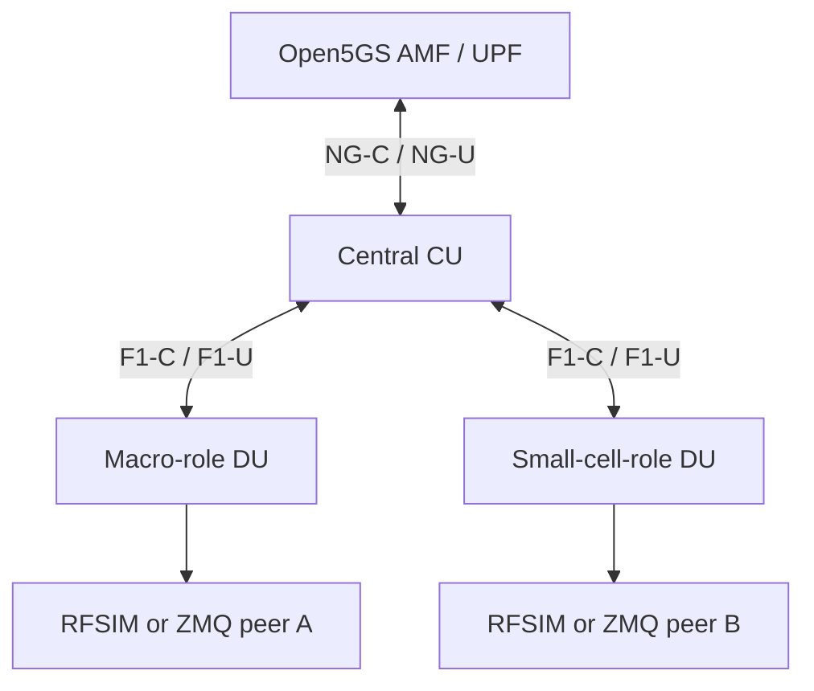
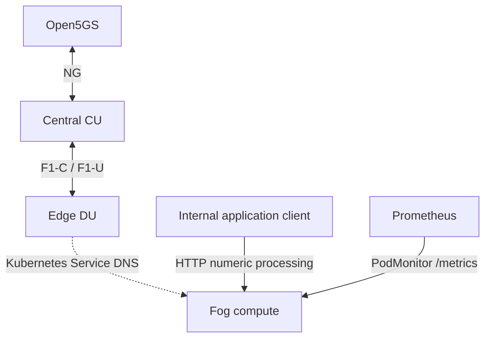

# Experimental H-CRAN and Fog-RAN profiles

Status: **STATIC VALIDATED**, with runtime acceptance outstanding. No new topology
has been deployed by this development task. Generation readiness is not radio
acceptance, Release certification, or proof of multi-DU interoperability.

## Standards boundary

H-CRAN and Fog-RAN are research/deployment labels, not separate 3GPP-standardized
RAN categories. These profiles use the existing gNB-CU/gNB-DU split, F1 and NG.
The software versions are newer than Release 16; the architecture follows the
listed Release 15/16 interface foundations, without claiming full conformance.

| Foundation | Exact normative reference | Use here |
|---|---|---|
| NR/NG-RAN description | [TS 38.300 V16.4.0, Release 16](https://www.etsi.org/deliver/etsi_ts/138300_138399/138300/16.04.00_60/ts_138300v160400p.pdf) | NR/NG-RAN terminology |
| NG-RAN architecture | [TS 38.401 V16.4.0, Release 16](https://www.etsi.org/deliver/etsi_ts/138400_138499/138401/16.04.00_60/ts_138401v160400p.pdf) | CU/DU decomposition and F1 |
| F1 principles | [TS 38.470 V16.4.0, Release 16](https://www.etsi.org/deliver/etsi_ts/138400_138499/138470/16.04.00_60/ts_138470v160400p.pdf) | DU-initiated F1 setup |
| F1 signalling | [TS 38.472 V16.0.0, Release 16](https://www.etsi.org/deliver/etsi_ts/138400_138499/138472/16.00.00_60/ts_138472v160000p.pdf) | F1-C over SCTP/IP |
| F1AP | [TS 38.473 V15.4.1, Release 15](https://www.etsi.org/deliver/etsi_ts/138400_138499/138473/15.04.01_60/ts_138473v150401p.pdf) | Setup, DU and cell identity |
| F1 data transport | [TS 38.474 V16.0.0, Release 16](https://www.etsi.org/deliver/etsi_ts/138400_138499/138474/16.00.00_60/ts_138474v160000p.pdf) | F1-U GTP-U/UDP/IP |
| NG principles | [TS 38.410 V16.4.0, Release 16](https://www.etsi.org/deliver/etsi_ts/138400_138499/138410/16.04.00_60/ts_138410v160400p.pdf) | Connection to 5GC |
| NGAP | [TS 38.413 V16.4.0, Release 16](https://www.etsi.org/deliver/etsi_ts/138400_138499/138413/16.04.00_60/ts_138413v160400p.pdf) | N2 signalling to AMF |
| 5GS architecture | [TS 23.501 V16.6.0, Release 16](https://www.etsi.org/deliver/etsi_ts/123500_123599/123501/16.06.00_60/ts_123501v160600p.pdf) | Core/PDU-session roles |
| 5GS procedures | [TS 23.502 V16.6.0, Release 16](https://www.etsi.org/deliver/etsi_ts/123500_123599/123502/16.06.00_60/ts_123502v160600p.pdf) | Future registration/session acceptance |

No new radio interface, coordination procedure or proprietary DU API is introduced.
There is no automatic inter-cell handover, CoMP, interference management, edge UPF
or local user-plane breakout in this implementation.

## Profile differences and inspected source status

| Profile | Kubernetes/research distinction | Radio foundation |
|---|---|---|
| C-RAN | Existing baseline centralized CU with one DU | Existing CU/DU/F1/NG configuration |
| vC-RAN | Explicit resource envelope and optional, disabled-by-default autoscaling capability | Same split; horizontal CU/DU state sharing is not asserted |
| H-CRAN | One CU, two cell-role DUs with distinct identities and radio settings | Standard F1/NG primitives; new topology is experimental |
| Fog-RAN | DU/fog placement controls plus local processing and telemetry | Existing split; compute placement is a Kubernetes choice |

The C-RAN/vC-RAN/Cloud-RAN sources have prior reference-system exercise; this task
checks their rendering preservation, not fresh runtime acceptance. Dedicated
O-RAN/OAI source and its existing E2 workflow are unchanged; CU KPM acceptance
remains outside this task. O-RAN/srsRAN remains blocked. Legacy H-CRAN monolithic
charts are retained as non-authoritative audit references. Traditional/monolithic
workflows are untouched and are not assumed to be operational merely from their names.

## H-CRAN



Both DUs are configured as independent cells under one CU. Centralized coordination
means common CU control through F1, not an implemented research coordination algorithm.

| Implementation | gNB ID | DU IDs | PCI | NR cell identity / sector | Actual role difference |
|---|---:|---|---|---|---|
| OAI | 3585 | macro 100, small 101 | 101, 102 | `(3585 << 14) + 1/2` | advertised SSB power -20 vs -35 dBm |
| srsRAN | 3585 | macro 100, small 101 | 101, 102 | sectors 1, 2 with 22-bit gNB ID | bandwidth 20 vs 10 MHz; gain 75 vs 35 |

Simulation power/gain settings do not demonstrate physical macro/small coverage.
RF peers must match the selected cell bandwidth and timing. There is no automatic
UE launch, ZMQ broker, or RF channel model. Each DU uses its own Pod network;
loopback ZMQ ports do not collide across Pods, but peers still need explicit routing.

Evidence for software capability:

- The exact srsRAN source revision `11c9bbabb69873752500d676f55e0034f6caa5c5`
  registers `gnb_du_id`, `sector_id` and CU `max_nof_dus` in its CLI schemas.
  [Pinned parser](https://github.com/herlesupreeth/srsRAN_Project/blob/11c9bbabb69873752500d676f55e0034f6caa5c5/apps/units/flexible_o_du/o_du_high/du_high/du_high_config_cli11_schema.cpp).
- [OAI upstream multi-DU implementation](https://gitlab.eurecom.fr/oai/openairinterface5g/-/merge_requests/2426)
  provides the implementation lineage. Cached 2026.w13 CU / 2026.w25 DU
  interoperability with these new profiles remains untested.

If the two-DU topology fails acceptance, use a reviewed reduced-capability profile
with the small DU's `replicaCount: 0`; report it as single-DU, never full H-CRAN.
The normal topology uses one CU and one replica of each DU. No HPA is enabled.

## Fog-RAN



The fog workload performs real bounded numeric aggregation through `POST /process`:
`{"values":[2,4,6]}` returns count, mean, minimum and maximum. It exports real
request/processed-value counters, uptime and DU Service DNS resolution through
`GET /metrics`. These are application telemetry, not fabricated radio KPIs.
It has no Kubernetes API token, no subscriber data, no radio-control privileges,
no persistent storage and no public NodePort. Processing is independent of F1/NG.

Defaults are a **single-node logical fog simulation**: CU, DU and fog can share a
node. For physical edge/cloud separation, configure the CU profile's node selector
for a central node and DU/fog selectors for an edge node. Merely setting metadata
is not proof of physical placement. The placement override is rendered on Pods.

Multi-node prerequisites include schedulable labelled nodes, cross-node Pod/Service
routing, SCTP support for F1/NGAP, UDP reachability for F1-U/NG-U, stable AMF Service
DNS, suitable MTU/latency and matching RF peers. srsRAN's verified local image must
be imported on every eligible node; there is no registry fallback.

## Canonical sources and registry

No CU/DU chart forks were created. Profiles live with their reusable canonical charts:

| Scenario | CU | DU roles | Additional chart |
|---|---|---|---|
| hcran-oai | `helm/cran-oai/cu/values-hcran.yaml` | `du/values-hcran-macro.yaml`, `du/values-hcran-small.yaml` | none |
| hcran-srsran | `helm/cran-srsran/cu/values-hcran.yaml` | analogous macro/small profiles | none |
| fran-oai | `helm/cran-oai/cu/values-fran.yaml` | `du/values-fran.yaml` | `helm/fog-compute/values-oai.yaml` |
| fran-srsran | `helm/cran-srsran/cu/values-fran.yaml` | `du/values-fran.yaml` | `helm/fog-compute/values-srsran.yaml` |

`config/scenarios.json` owns the scenario keys, profiles, releases, images and KNF/NSD
identities. The existing deterministic generator bakes profile values into each KDU
and validates references, identities and rendered resources. Legacy H-CRAN charts,
legacy archives and the additive `fran` MEC key are preserved. Their stable-AMF
package-only fix is supplied by the selected canonical CU implementation.

OAI image versions remain 2026.w13 (CU) / 2026.w25 (DU). Their existing digest-verification
deferral is not strengthened by this work. srsRAN uses the existing verified-import
local tag with manifest integrity lock and `Never` pull policy. Fog compute uses the
already-approved digest-pinned Python helper image; no new image build is needed.

Existing C-RAN/vC-RAN/Cloud-RAN default rendered resources remain unchanged.
srsRAN new profiles retain memory requests and CPU limits, but intentionally omit
hard memory limits because of the previously observed cgroup-ceiling OOM behavior.
The four stateful radio profiles restrict replica counts to 0/1 rather than promising
safe horizontal radio replication.

## Monitoring

Existing dashboard Runtime/Events/Logs use canonical scenario keys and catalog pod
names. Existing cache, process limits and polling cadence are preserved. Prometheus
can monitor new RAN Pod readiness and CPU/memory through kube-state-metrics and kubelet:

```promql
kube_pod_container_status_ready{pod=~"(hcran|fran)-(oai|srsran)-.*"}
rate(container_cpu_usage_seconds_total{pod=~"(hcran|fran)-(oai|srsran)-.*"}[5m])
container_memory_working_set_bytes{pod=~"(hcran|fran)-(oai|srsran)-.*"}
```

Fog's PodMonitor requires the Prometheus Operator CRD and selects the real metrics
port. It uses the existing `release: kube-prometheus-stack` label. Its namespace is
that of the Helm release. Set `monitoring.enabled: false` only for environments
without the CRD, and document the missing telemetry integration. No RAN-specific
Prometheus exporter or KPM success is claimed for these profiles.

## Explicit deployment workflow (not executed during development)

Before deployment, review capacity and isolate a test environment. This reference
machine is CPU constrained; two RF simulators must not be started casually.

Local preparation/validation only:

```bash
python3 -B scripts/osm_packages.py prepare hcran-oai hcran-srsran fran-oai fran-srsran
python3 -B scripts/osm_packages.py validate hcran-oai hcran-srsran fran-oai fran-srsran
```

After review, onboarding is an explicit separate operator action via the existing
`scripts/osm-onboard.sh` workflow. Then select H-CRAN/Fog-RAN and OAI/srsRAN in the
dashboard and accept its experimental warning, or explicitly use:

```bash
./deploy.sh --experimental hcran-oai
```

This uses the existing serialized OSM lifecycle with catalog provenance and
preflight validation. Experimental deployment refuses any recorded active RAN NS;
normal undeployment must be separately authorized before this workflow.
The installer, autonomous watcher and default benchmark batch exclude these experimental profiles. No new
scenario is instantiated or onboarded merely by dashboard startup.

Source changes require a reviewed dashboard service reload later; none is performed
by this task. Existing generated packages need revalidation/preparation after
canonical-source or registry changes; strict drift checks are deliberately retained.

## Local static checks

```bash
PYTHONDONTWRITEBYTECODE=1 python3 -B -m unittest discover -s tests -p 'test_architecture_profiles.py'
```

For a direct chart check, supply the central image binding rather than a mutable tag:

```bash
python3 -B scripts/runtime_images.py values hcran-oai cu > /tmp/hcran-cu-images.json
helm lint helm/cran-oai/cu --strict -f helm/cran-oai/cu/values-hcran.yaml -f /tmp/hcran-cu-images.json
helm template hcran-oai-cu helm/cran-oai/cu -f helm/cran-oai/cu/values-hcran.yaml -f /tmp/hcran-cu-images.json
```

These commands render locally; they do not install, onboard or instantiate anything.

## Runtime acceptance and rollback

Static tests cannot establish F1/NGAP, multi-DU acceptance, radio timing, UE registration
or PDU connectivity. Future tests must prove CU/each DU readiness, distinct F1 Setup
identities, stable NGAP/F1 SCTP, matching RF peers, UE registration/session traffic,
unchanged core health, and fog placement/processing/scraping on intended nodes.

Use the existing failed-operation reconciliation and successful-pending adoption
paths; do not delete resources by matching broad labels. After an explicitly authorized
switch, rollback through the same dashboard/OSM workflow to the prior canonical
scenario. The service does not atomically restore a previous NS if a new instantiate
fails: pending identity is retained for verified recovery. That existing limitation
also applies here. Do not use a generic Helm rollback to bypass OSM ownership.

Classification:

- **STATIC VALIDATED**: profiles, naming, Helm schema/render and local fog behavior.
- **DEPLOYMENT READY**: not established. KDU startup ordering, per-DU F1-U addressing and runtime radio interoperability remain unverified.
- **RUNTIME VERIFIED / END-TO-END VERIFIED**: neither achieved for these four new scenarios.

## Static review readiness caveats

The KNFD lists CU before its DUs (and fog last), but this list does not encode an
OSM dependency graph or prove serialized installation. The original inherited startup scripts
resolved CU/AMF DNS once. Experimental profiles now use bounded dependency discovery
to tolerate parallel Service creation; existing profiles keep their original renders.
A future isolated acceptance must establish ordering/recovery before using these
profiles to replace a working RAN.

F1-C targets are explicit, but F1-U is inherited from the existing split chart.
The experimental srsRAN profiles now explicitly bind F1-U to substituted Pod IPs;
actual tunnel establishment and advertised endpoint use remain runtime prerequisites.
The inspected pinned srsRAN DU parser defaults an unspecified F1-U socket bind to
127.0.10.2. That source observation is a readiness concern, not proof of what the
cached binary ultimately uses. The pinned parser confirms bind_port/peer_port and socket.bind_addr support;
CU-UP advertised endpoint behavior still needs runtime verification.
Do not infer user-plane connectivity from F1-C SCTP or successful Helm rendering.

Events deliberately reports experimental topology acceptance as PARTIAL until
per-DU control/user-plane acceptance is established; a shared F1 log line cannot
prove both macro and small-cell paths. Missing expected components are named.
Fog HTTP connections have a five-second request-read deadline; a stalled client
cannot retain the sole HTTP handler indefinitely. No live workload was changed.

## Deployment-readiness corrections

Experimental profiles now opt into `experimentalTransport: true`; existing C/vC/Cloud
profiles retain their original generated configuration. Both CU and DU resolve IPv4
dependencies with a 120-second deadline and bounded individual lookup attempts.
A failed lookup exits before launching the RAN binary. Kubernetes can retry the pod;
no fixed startup sleep or descriptor-order guarantee is claimed. Fog similarly waits
for its DU Service DNS before serving. A Service existing is not protocol readiness:
the RAN binary must still complete F1/NGAP, which remains an acceptance prerequisite.

Pinned srsRAN source `apps/helpers/f1u/f1u_cli11_schema.cpp` supports `socket` entries
with `bind_addr`, plus `bind_port`/`peer_port`. The experimental CU uses
`cu_up.f1u.socket: [{bind_addr: POD_IP}]`; each DU uses
`f1u.socket: [{bind_addr: POD_IP}]`. Existing substitution converts POD_IP to its own
pod address. This overrides the parser's unspecified-DU socket loopback default;
CU Service exposes UDP2152 as well as F1-C SCTP38472. Distinct DU Pod addresses
provide independent transport endpoints; actual per-UE TEID handling is not static proof.

OAI revision-specific `gnb_config.c` falls back from an absent DU F1-U-specific
address to `local_n_address`, already POD_IP. CU uses `local_s_address=POD_IP`;
DU connects through `remote_n_address=CU_IP`. Existing data ports38472 are preserved.
Experimental OAI Services now expose UDP38472 in addition to SCTP38472; UDP2152
on the CU remains the NG-U port. Pod-IP F1-U routing still requires cluster pod routing.

Experimental deployment refuses to tear down any recorded active RAN NS. An operator
must separately authorize and complete the existing normal undeployment workflow
before experimental instantiation. `--experimental` is acknowledgement, not permission
to delete an active deployment. Failed experimental attempts retain pending identity;
existing reconciliation checks owned NS name/operation and excludes core/active/additive
instances. No namespace deletion, PVC deletion, manual Helm removal, or automatic
previous-NS restoration is introduced. Experimental charts contain no PVCs.

These corrections address source defaults and discovery races, but simultaneous
multi-DU binary behavior, RF peer configuration, user-plane delivery and multi-node
placement remain unverified. All four scenarios retain STATIC VALIDATED status.

H-CRAN srsRAN explicitly sets supported `cu_cp.max_nof_dus: 2`; this permits two
DU connections in configuration and does not certify multi-DU runtime behavior.

## Optional simulated OAI UE preparation

`scripts/prepare_simulated_ue.py` can prepare private replicas-zero manifests for
`fran-oai` and either H-CRAN OAI cell. H-CRAN requires explicit `--cell macro` or
`--cell small`; there is no automatic dual-cell association. The selected catalog
DU's exact app label drives Pod-IP discovery at UE startup. No host address or
load-balanced multi-DU RF Service is used. Experimental resource names are unique
per scenario/cell, including Secrets, discovery ConfigMaps and read-only pod-reader
RBAC. Existing C/vC/Cloud UE output and O-RAN helper policy remain unchanged.

Before reuse the helper renders/lints the selected DU and rejects carrier drift
from the known band78, numerology1,106-PRB, frequency/SSB and RF-server4043 setup.
PCI and NCI are different per H-CRAN cell; the UE synchronizes to its explicitly
selected DU, rather than claiming simultaneous macro/small connectivity. Actual
experimental UE registration/PDU compatibility remains unverified.

Prepare only with private input, for example (not a deployment command):

```bash
python3 -B scripts/prepare_simulated_ue.py --scenario hcran-oai --cell macro \
  --subscriber-input /private/subscriber.json --output .runtime/ue-hcran-macro.yaml
python3 -B scripts/prepare_simulated_ue.py --scenario hcran-oai --cell small \
  --subscriber-input /private/another-subscriber.json --output .runtime/ue-hcran-small.yaml
python3 -B scripts/prepare_simulated_ue.py --scenario fran-oai \
  --subscriber-input /private/subscriber.json --output .runtime/ue-fran.yaml
```

These examples need real owner-only private inputs. Do not run two UE instances
with the same subscriber identity simultaneously. No subscriber values are printed
or added to tracked files. Dashboard/validation discovery includes the new labels;
the existing UE summary still describes one selected discovered pod, not an
aggregate multi-UE acceptance result. All generated Deployments remain replicas0.

## srsRAN ZMQ peers: no automatic RF deployment

No reviewed compatible NR ZMQ UE image/deployment exists in this repository.
Optional peer deployment therefore remains absent/disabled. The approved DU uses
ZeroMQ, not OAI's RFSIM wire protocol. Plugin/build settings alone are not a working
RF connection. For each independent DU the required endpoint pairing is:

| Endpoint | Current per-DU network namespace |
|---|---|
| DU transmit bind | tcp://127.0.0.1:2000 |
| DU receive peer | tcp://127.0.0.1:2001 |
| Compatible UE transmit bind | tcp://127.0.0.1:2001 |
| Compatible UE receive peer | tcp://127.0.0.1:2000 |

This is the transport pairing, not a validated UE command. Macro and small DUs
have distinct Pods/network namespaces, so both may use2000/2001 without collision.
A peer must share its own DU's network namespace or use an explicitly reviewed
bridge. A separately scheduled UE Pod cannot reach another Pod's loopback. Cross-Pod
support would require non-loopback bind/peer configuration and reachable per-DU
IPs, not merely a Kubernetes Service. No such RAN/network change is made here.
A shared namespace/broker design would need separately assigned port pairs and
per-cell routing; no broker or fake connectivity is introduced.

Profiles use sample rate23.04, band78 and SCS30; macro/edge20MHz and small10MHz.
The [official ZMQ UE tutorial](https://docs.srsran.com/projects/project/en/latest/tutorials/source/srsUE/source/)
explains crossed TX/RX endpoints, but its UE restrictions/configuration are not
proof of compatibility with these exact pinned binaries or profiles. A reviewed
peer must match sample rate, bandwidth, numerology, PLMN/slice and frequency.
No USRP/UHD or RF configuration is changed.

## Bounded fog DNS and lightweight cache metadata

Fog DNS lookups now execute in one short-lived Python child per lookup, bounded
to2s (or remaining startup budget), with child cleanup on timeout. Startup retains
its120s deadline and1s retry backoff; /metrics reports DNS availability0 on lookup
failure. No resolver thread can accumulate indefinitely, and DNS failures do not
expose private subprocess output. Tests include a genuinely stalled child process.

`scripts/image_metadata.py` reads only containerd image listings, manifests/indexes
and image configs. It never reads OCI layers, hashes binaries, mounts images, starts
containers, executes RAN binaries, invokes sudo, or mutates Kubernetes/containerd.
Commands have at most5s each within a20s shared budget; metadata reads are capped
at4MiB after completion. JSON is retained for partial failures. Only approved
revision/platform/digest fields are emitted, never image Env/history/raw labels or
stderr. Use operator-provided socket access; no privileged invocation was performed
by development. This metadata cannot establish application parser compatibility.

All four profiles remain STATIC VALIDATED. Binary parser, advertised F1-U tunnel,
RF peer/UE, multi-DU and physical edge acceptance remain outstanding.
