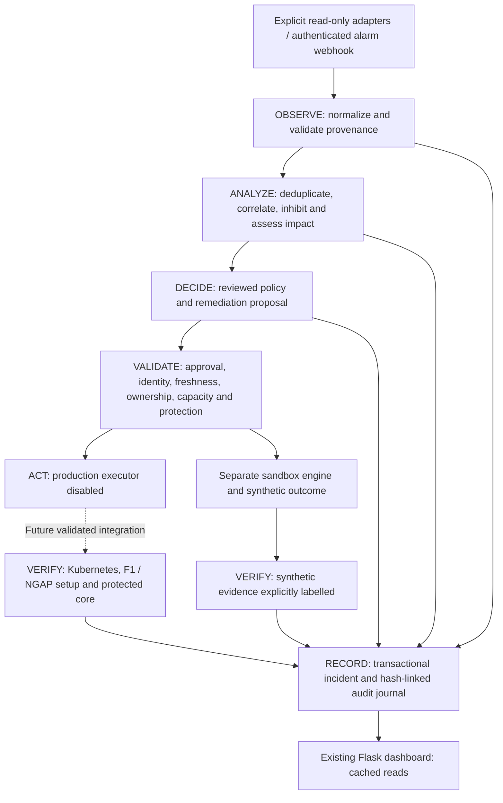

# Architecture and operational contracts

Components are import-safe Python modules in `scripts/assurance`. `model.py`
normalizes bounded operational fields and strips annotations, tokens, logs and
subscriber identifiers. `adapters.py` handles observation and unavailable/stale
measurements. `engine.py` provides event processing and a checked incident state
machine. `policy.py` separates planning, validation, verification and execution.
`store.py` serializes updates with SQLite transactions, fsync durability and an
append-only audit table. `governance.py` reuses the backend's lifecycle lock and
state validation for a future approved operation. `simulation.py` has no production
executor import or callback. `api.py` registers authenticated operational endpoints;
`cli.py` supplies one-shot collection and sandbox runs. No background thread or
polling loop was added.

Alarm objects carry an alarm ID; type; reviewed minimum severity; source; cluster,
namespace, node and resource identity; NS/VNF/KDU identity; event/first/last times;
state; observations; evidence classification; probable-cause hypothesis; impact;
recommendation; automation eligibility; acknowledgement and resolution;
correlation ID; and runbook. Unknown identity remains `unknown`, not a fabricated
OSM relationship. `confidence` describes a source assertion, not proof of causality.
Corroboration checks supporting fields and contradictory evidence; it does not claim
independent source validation. Automatic eligibility is always false.

Deduplication keys include condition, cluster, namespace, resource, service and
provenance. Duplicate delivery is idempotent; equivalent Rancher/Prometheus routes
do not create two incidents. Out-of-order updates cannot clear newer alarms.
Persistence uses distinct observation timestamps and resets on excessive gaps or
condition changes. A single event cannot satisfy nonzero persistence. Recovery
requires a sustained resolved sequence. Flapping tracks transitions over ten
minutes, suppresses proposals after four transitions, and retains at most 20 entries.
Cooldown defaults to ten minutes; unknown cooldown blocks any future action.
Maintenance suppresses proposals while preserving alarm evidence and audit.

Node root alarms inhibit child alarms only with matching known cluster/node IDs.
CU/DU hypotheses inhibit protocol-loss alarms only within the known NS and namespace.
Related alarms link to one active incident; cleared conditions cancel pending
proposals and resolve only when every linked alarm has cleared. Root-cause hypotheses
are heuristic, not diagnostic proof. Existing incidents retain their original
hypothesis; operator triage is required when later correlated evidence changes it.

Incidents progress DETECTED → TRIAGED → CORRELATED → IMPACT_ASSESSED →
ACTION_PROPOSED → APPROVAL_PENDING or ESCALATED. EXECUTING and VERIFYING are used
only by the sandbox in this implementation. Incident records retain source alarms,
resource IDs, proposed action, decisions, OSM operation identity if known, verification,
recovery duration and final outcome. Audit records are hash-linked and cannot be
updated/deleted through normal SQLite operations. This is immutable-style history,
not WORM storage: a host/database administrator could replace the database.

The journal is separate from `active-ran.yaml`; no deployment state migration is
required. A future executor must take the existing `.lifecycle.lock`, re-read and
validate the bound runtime context, inspect pending operations/recovery journals and
confirm protected core separation. No live lock was acquired during this change.
SQLite transactions do not substitute for the OSM lifecycle lock.

Read responses are capped to 500 objects per collection and 100 recent audit events.
Historical records remain on disk. Event correlation currently scans retained alarm
and incident objects; large-scale retention/indexing and background queue ownership
need review before a high-volume deployment. This is sized for the current laboratory.

The optional timestamped application-log adapter distinguishes explicit F1/NG Setup
messages, configuration/parser failures, cell activation, RRC, registration and PDU
assertions. Old or untimestamped lines remain STALE/UNAVAILABLE. It does not retain raw
logs or subscriber strings. This adapter is tested offline, not scheduled against live
CU/DU. Contradictory or missing supporting fields reduce targeted recovery proposals
to observation/escalation. Reusing broad historical dashboard strings as fresh protocol
proof would be unsafe, so the existing dashboard event API remains available separately.
