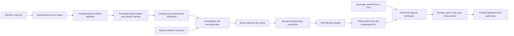

> Historical P0 design baseline at c63aa1c. See ../README.md for implemented MVP scope.

# P0 architecture inventory and proposed boundaries

Audit date: 2026-10-15. Repository `/home/rclab/5g-kubernetes-cicd`, clean branch
`feature/telecom-cicd`, HEAD `c63aa1c002e0ca0bb1b4100ba3b0457e531a734c`.
Read-only `ls-remote` confirmed the published `reproducible-installer` branch at that
same commit. This supersedes the earlier failed-push state in the conversation.
The branch name differs; source content matches the requested published baseline.

This is static architecture review, not live acceptance or a conformance certificate.
No cluster/OSM workload queries, tests, builds, imports of executable application
modules, service operations, commits or pushes were performed. Source and official
documentation were read; only audit documents/evidence under this `/tmp` directory
were created. `tracked-file-inventory.json` inventories all 1,046 tracked paths.

Protected existing NSs remain outside every proposed initial trial:

- Fog-RAN `2c128db3-e27e-4dbe-8854-17751ba17680`.
- Open5GS `1b1cb300-b571-43f2-a567-6540895d7d0f`.

Their current health is NOT VERIFIED in this audit; no request capable of changing
them was issued. Existing production runtime configuration was not loaded.

## Existing components and reuse decisions

| Area | Existing implementation/evidence | Reuse and boundary |
|---|---|---|
| Kubernetes/platform | `scripts/installer/{install.py,host.sh,reference.py}`, `scripts/runtime_config.py`, `scripts/common.sh` | Reuse context/cluster/namespace identity validation and manifests; installer is a fresh-machine provisioning workflow, not a researcher build/deploy worker. |
| Rancher | Installer/rendering, port-forward service, dashboard embed integration | Keep cluster inventory/operator visibility. Do not create a second lifecycle owner for OSM-managed NFs. Actual Fleet inventory not inspected. |
| OSM v19 | `ran-selector/osm_client.py`, `scripts/osm_catalog.py`, `scripts/osm_onboard.py`, patched/pinned installer | Reuse TLS/no-redirect client and exact UUID/content verification; extend with explicit capability-tested lifecycle operations. Current client has create/terminate/delete/poll, not a validated KDU upgrade/rollback adapter. |
| Helm/package source | `config/scenarios.json`, `scripts/{scenario_registry,osm_packages}.py`, canonical `helm/cran-{oai,srsran}` | Keep one scenario registry and immutable source/package pipeline. Extend the contract for provider roles; do not duplicate chart generation. |
| Core source | Reviewed vendored Open5GS package/chart, `reference-versions.json` | Reuse known reference integration and private-input separation. General external-Core support and database migration/rollback are not implemented by this chart. |
| RAN profiles | C-/Cloud-/vC-/O-/H-/Fog profiles and OAI/srsRAN inputs | Preserve current profile metadata. H-/Fog variants explicitly experimental; O-RAN/srsRAN blocked. Dashboard USRP packaging explicitly refuses the unwired path. Static generation readiness is not telecom acceptance. |
| Image/build | `runtime_images.py`, `srsran_image.py`, `image_metadata.py`, `build_srsran_from_source.sh` | Reuse policy, digest/archive/CRI checks and provenance. Existing build starts Docker, installs tooling, uses native CPU flags/all cores and imports into local containerd: never execute it as untrusted researcher CI on the service host. |
| Dashboard/API | `ran-selector/backend.py`, `index.html`, `monitoring.py`, `assurance.js` | Extend this UI with proposal/build/approval views. Keep bounded caches/read paths. Existing scenario deploy route is replacement-oriented, not a safe generic running-update API. |
| Runtime ownership | `state_schema.py`, `runtime_config.discover_context`, `.lifecycle.lock`, atomic writes | Reuse identity binding, pending-instance reconciliation and same-host serialization. Current model represents one active RAN/core plus additive instances, not a multi-tenant NF graph. |
| Layer 2 | `monitoring/ran-exporter`, native Open5GS PodMonitor, latency probe, Prometheus/Grafana integration | Reuse actual metrics and source adapters. RAN exporter is implementation-specific log parsing; TCP-connect probe is not PDU-session throughput/latency. |
| Layer 3 | `scripts/assurance/*`, policy catalog, guard/guardian, SQLite audit, dashboard blueprint | Reuse telemetry provenance, incident correlation/deduplication, safe journal transactions, resource supervision and proposal governance. Keep production executor disabled and LIVE_AUTO rejected. |
| Recovery | `scripts/recover_experimental_ran.py`, pending adoption/reconciliation APIs | Reuse matching-ID approval and uncertain-operation handling as patterns, not an automatic recovery feature. Explicit protection in these paths is not a universal mutation guard. |
| Infrastructure/mesh | Installer Flannel, ingress, Longhorn, monitoring, Istio; workload networking values | Retain platform ownership. Networking/security and vendor compatibility need a certified matrix; mesh must not be assumed suitable for SCTP/GTP-U/radio traffic. |
| CI | `.github/workflows/helm-validate.yml`, `osm-onboard.yml` | Published baseline performs offline tests on hosted runners and manually dispatched read-only catalog preflight. It does not yet implement generic image build/promotion or controlled live updates. |
| Verification | `tests/*`, `docs/project-review/GIT-2.md`, L3 trial reports | Prior GIT-2 evidence: 609 tests plus two CI tests, with 16 simulations. Historical evidence only; no suite rerun in P0. |

## Target ownership model

Use the existing repository/dashboard as the control-plane front end. Add only
missing provider contracts, source ingestion, isolated build orchestration and a
reviewed deployment coordinator around existing package/client/governance modules.

**One authoritative writer per resource set.** OSM remains lifecycle authority for
an OSM-managed NS/VNF/KDU; its selected Helm or declarative backend is below that
boundary. Rancher/Fleet may own separate platform resources. A researcher-owned
external NF is only a peer until its owner separately authorizes management.
Direct Helm/Kubernetes changes are not fallback updates to an OSM-owned release.
OSM's newer declarative application/Flux path is a separate capability lane, not
proof that existing KDU NS instances can be migrated or managed by another writer.

Git source, signed release intent, OSM catalog objects and observed running state
are distinct records. A branch moving, a catalog PUT succeeding or a Pod becoming
Ready must not promote all four records to one shared 'deployed' state.

Fleet explicitly supports ownership override/drift correction options, reinforcing
the need to keep reconcilers disjoint; those options must not be used to take over
existing OSM resources. [Fleet reference](https://fleet.rancher.io/reference/ref-fleet-yaml).

## Telecom interface boundaries

Model composition by NF roles and interface contracts, not vendor names or only
C-RAN/Fog-RAN labels. Release/profile interoperability must be stated and tested.

| Role boundary | Required contract and validation |
|---|---|
| DU ↔ CU | F1-C/F1AP and SCTP; F1-U/GTP-U endpoints, routing and MTU; DU/cell identity, PLMN/TAC, numerology and radio compatibility. SCTP establishment alone is not F1AP setup success. |
| CU-CP ↔ CU-UP, if split | E1/E1AP plus endpoint identity, bearer compatibility and independent component version binding. Do not invent an E1 split in current monolithic-CU profiles. |
| RAN ↔ AMF | N2/NGAP over SCTP; supported PLMN/TA/slice set, gNB identities, association and NG Setup success. |
| RAN ↔ UPF | N3/GTP-U reachability, tunnel identity, address family/MTU, routing; verify with an authorized test session. |
| SMF ↔ UPF | N4/PFCP association and session programming; CPU/pod readiness cannot prove a working data plane. |
| Core NF ↔ Core NF | Selected SBA/NF discovery, certificates, API versions, SBI reachability and authentication; NRF presence depends on declared architecture. |
| UE ↔ Core | N1/NAS capability and approved test subscriber, registration, authentication and PDU session. NAS is a logical UE–AMF interface carried through the RAN, not another arbitrary exposed Pod port. |
| UPF ↔ data network | N6 routes, forwarding, NAT policy where appropriate, DNS and traffic validation. |
| Optional extensions | Xn, O-RAN E2/KPM, O1, fronthaul/eCPRI and hardware timing are separately declared capabilities; absent features remain unavailable, not mandatory for every provider. |

These interface choices follow the architecture foundations in
[3GPP TS 38.401 Release 16](https://www.etsi.org/deliver/etsi_ts/138400_138499/138401/16.04.00_60/ts_138401v160400p.pdf)
and [3GPP TS 23.501 Release 16](https://www.etsi.org/deliver/etsi_ts/123500_123599/123501/16.06.00_60/ts_123501v160600p.pdf).
They do not assert that existing implementations are certified to either release.
