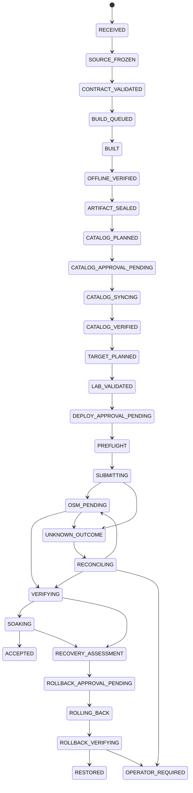

> Historical P0 design baseline at c63aa1c. See ../README.md for implemented MVP scope.

# Proposed CI/CD state machine

A durable orchestration record extends existing validation/audit conventions.
It is distinct from the L3 observation/incident journal and does not change L3
modes. Reuse existing journal/atomic-write patterns behind interfaces; do not copy
the incident engine into a second deployment engine or migrate production journals
as part of initial development. Keep one coordinator and local durable store first;
certify shared transactional storage/leases before HA or distributed workers.

## Release and target state

These are proposed states, not implemented APIs. Intermediate artifacts may be
retained without a deployment. External-readonly mode stops at approved observation;
image/chart-only submissions enter artifact verification after source provenance
classification. New isolated service deployment and running update use different
approved plan types; a create test does not certify an upgrade.

## Transition contract

| Boundary | Mandatory guard/evidence | Who can authorize |
|---|---|---|
| RECEIVED → SOURCE_FROZEN | Authenticated provider/repository; event deduplication; immutable snapshot; source and workspace bounds | Intake policy; no production permission |
| CONTRACT_VALIDATED → BUILD_QUEUED | Owner/license/interface/security contract; sandbox capacity; executable inputs considered untrusted | Build policy/privilege reviewer |
| BUILT → ARTIFACT_SEALED | Offline tests, descriptors/Helm, vulnerability/license policy, exact OCI/chart/package hashes, provenance/SBOM/signature verification | Artifact promotion policy |
| CATALOG_PLANNED → CATALOG_SYNCING | Exact identity/hash/OSM project, immutable or proven-unused policy, reference inventory and content comparison, separate approval | Catalog maintainer scoped to tenant/project |
| TARGET_PLANNED → LAB_VALIDATED | Compatibility/capability proof; isolated peer/UE/data permissions; actual update/rollback rehearsal when requested | Lab operator, separately approved execution |
| DEPLOY_APPROVAL_PENDING → PREFLIGHT | Approval binds target/release/operation/expiry/window/disruption/rollback plan; protected and foreign resource deny | Authorized environment operator plus owner/security approvals where required |
| PREFLIGHT → SUBMITTING | Fresh authoritative target/peer health and ownership, no lifecycle conflict, capacity, rollback availability, lock/lease, durable intent | Deployment coordinator enforcing the bound approval |
| OSM_PENDING → VERIFYING | Bound operation terminal COMPLETED; no ambiguous or partial state | Coordinator; no success inferred from HTTP acceptance |
| VERIFYING → SOAKING → ACCEPTED | Expected runtime bytes/config and NF interfaces; test success for a defined observation window; monitoring fresh; continuity budget met | Verification policy and operator release decision |
| Recovery path | Stop/freeze; assess affected state; approved compatible compensating action; verified restored effect | Separately authorized rollback, or precisely preauthorized rollback envelope |

No gate defaults unknown to true. Test outcomes are PASS, FAIL, UNAVAILABLE or
NOT_RUN; telemetry provenance is LIVE, STALE, UNAVAILABLE or SIMULATED. A plan is
blocked when a required source/test is unavailable. Optional absent KPM can be
reported without falsely failing a provider that does not claim it.

## Failure, concurrency, cancellation and recovery

- Any pre-submission stage may end REJECTED, FAILED, EXPIRED or CANCELLED with a
  durable reason. Failed build can be resubmitted as a distinct job; never silently
  repeat lifecycle side effects. Provider push events do not auto-approve deploys.
- Superseded builds may be cancelled before catalog/deploy submission; approved
  artifact bytes cannot change under the same plan. A new Git commit requires a
  new release/plan, not mutation of an in-flight job.
- Deduplicate event delivery by provider/repository/delivery identity and jobs by
  immutable snapshot/recipe/environment generation. Do not deduplicate different
  approved target operations merely because source commits match.
- Record stage start/end, attempts, deadlines, lease owner, policy/config version,
  monotonic duration, wall timestamps, evidence hash and resource/request budgets.
  Persist state CAS/outbox intent before network submission; do not hold SQLite
  transactions while waiting for builds, APIs or approvals.
- One in-flight mutation per target service/dependency conflict set. Existing local
  `.lifecycle.lock` is the shared compatibility lock; graph-aware coordination must
  also cover shared Core, radio and referenced catalog resources. No lock held for
  a human approval wait. Recheck under lock immediately before submission.
- Uncertain catalog creates can also leave orphaned entries. Reconcile by bound
  name/version/content/project and original operation evidence before any retry;
  if unique ownership is not established, require an operator.
- Parent crash, worker exit, network timeout and malformed child output after a
  possible submission become UNKNOWN_OUTCOME. A process restart must reconcile,
  never blindly resume from an in-memory 'not sent' assumption.
- Cancellation before submission is local. After submission use CANCEL_REQUESTED
  and continue bounded observation or handoff to an operator. Do not claim OSM or
  hardware stopped because local polling stopped. Emergency stop blocks new writes.
- Preauthorized rollback may only run the exact bounded, validated compensation
  in the signed approval. Otherwise stop at ROLLBACK_APPROVAL_PENDING. A rollback
  cannot bypass protected-resource, schema compatibility or ownership gates.
- No automatic NS termination, forced deletion, target switching, Core restart or
  live remediation is introduced by this design.

## Monitoring and lab resource budget

Reuse existing bounded observe-once/guardian logic and cached UI data; do not add
one polling loop per browser, CI stage or provider. Correlate release/job/target IDs
with existing incident IDs without rewriting incident history. Preserve the four
historical monitoring incidents as evidence, not fresh assertions; correlate scrape
endpoint problems separately from confirmed NF/service failure. Missing data cannot
clear alarms or prove health. Freshness uses source/sample time and ingestion time.

A first future monitoring design can use the existing 60/90/120-second interval
choices with one collector at a time and explicit per-source/overall budgets;
interval/continuous operation require later approval. Historical L3-4B evidence
(~1.63 CPU-seconds/cycle at 60 s) models ~0.027 core, or ~0.68% of four cores on
average, excluding UI/exporters/other services and peak contention. Collector-tree
peak was ~74 MiB in that report; it is not a current measurement or total platform
budget. Do not infer acceptable DU impact from that average.

Keep build/image import/performance generation off the four-core host. Gate future
trials on actual spare capacity, CPU PSI, DU deadline/late-slot counters where
available, node pressure, memory/process-tree RSS, request counts and protected
health. Reuse existing validated watchdog thresholds; do not relax them as part of
CI feature delivery. A slow source consumes its bounded deadline and becomes
unavailable; it does not start overlapping collections or block critical health
checks behind a database writer. Any new active tests need separate budgets and
approval. P0 starts no polling or test traffic.
